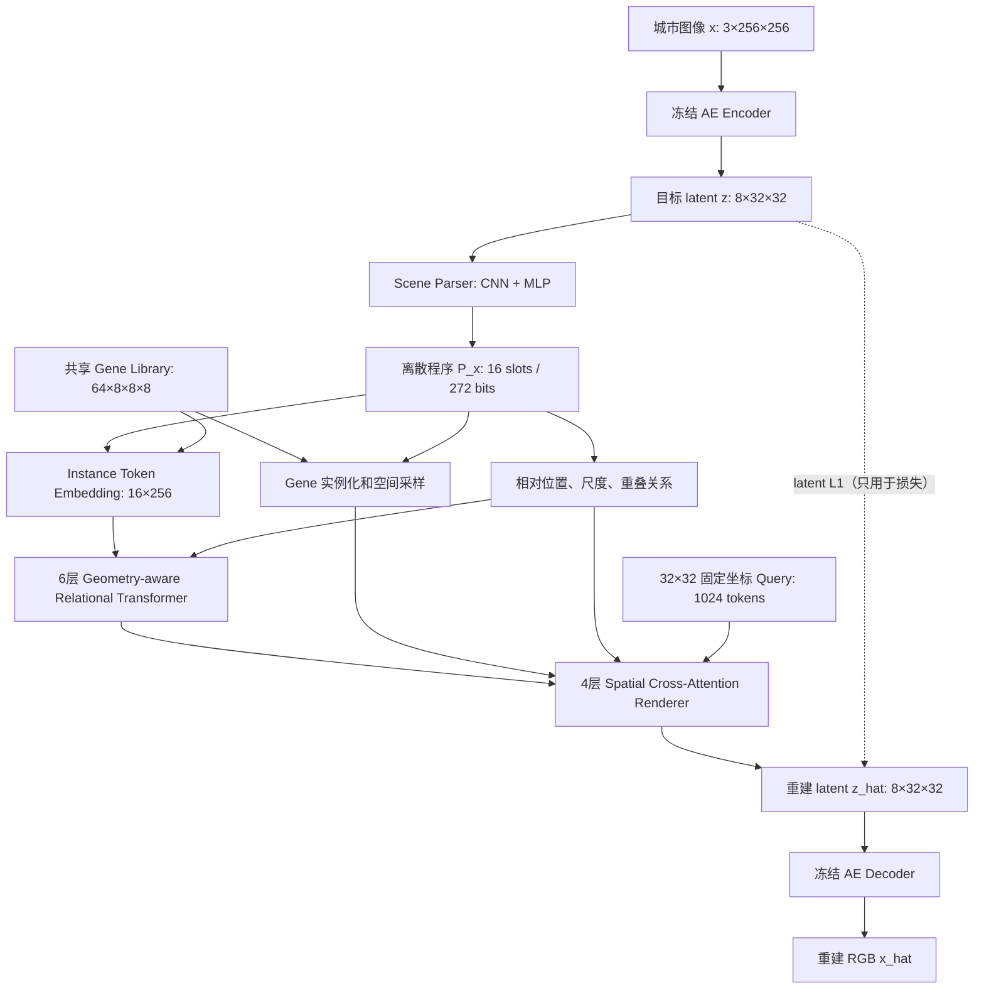

# UrbanGene V1.1 改进需求文档：Geometry-aware Relational Compositional Transformer（GRCT）

**版本：** V1.1（替代 V1.0 的主组合模型规格；面向 Codex 的增量开发 PRD）  
**日期：** 2026-11-08  
**项目定位：** 组合式潜在视觉表征研究 / 受限场景程序 / 合成城市场景重建与重组  
**文档状态：** 技术设计与实验要求；**不表示已经实现或已有科学结果**  
**关联文档：** `REQUIREMENTS.md`、`TRAINING_PLAN.md`、`README.md`、原 `UrbanGene V0` 配置与运行日志  
**本次替换：** 将原 V1.0 的 *Learnable Residual CNN（原 R2 主方案）* 降为辅助对照，**正式主方案改为 GRCT：Geometry-aware Relational Transformer + Spatial Cross-Attention Renderer**。

---

## 0. 核心决策及不可变要求

### 0.1 一句话目标

在**共享 Gene 库、离散场景程序、冻结图像 AE、单一重建目标**不变的前提下，训练一个直接接收 **Gene 实例及其几何关系** 的可学习组合模型：先使用实例间的 Relational Self-Attention 学习相互作用，再利用像素/latent 位置对实例的 Spatial Cross-Attention 重建潜在画布。核心验证不是单纯提高重建精度，而是验证**有限基因在未见组合和 A+B→C 重组任务中的表现**。

### 0.2 为什么选择 Transformer，而不是强化学习或 Residual CNN

- **不使用 PPO/强化学习**：目前训练任务具备目标 latent 与可微训练路径，没有必要引入奖励设计和序列试错。
- **不把 Residual CNN 作为主方案**：先做固定平均再 CNN，会提前丢失单个 Gene 实例的身份、相对关系、重叠与位置细节；CNN 是合理的局部修正基线，但未必是有效的实例组合器。
- **GRCT 的研究假设**：让实例先交互、再渲染到空间位置，可以比先融合、再修正更好地表示不同 Gene 之间的几何和潜在特征关系。
- **性质限制**：GRCT 是一个候选架构，**尚未证明优于 CNN 或固定融合**；须通过预算匹配对照和独立重组实验验证，不能仅凭架构形式宣称“学会通用场景语法”。

### 0.3 必须保留 V0 的实验约束

| 项目 | V0 定义 | V1.1 要求 |
|---|---|---|
| 输入 | 256×256 合成城市 RGB 图像 | 不变 |
| AE | 确定性卷积 AE，编码为 `8×32×32` | AE 训练好后冻结，所有模型共享同一 checkpoint |
| Scene Parser | CNN+MLP，最多 16 个离散槽位 | 首版尽量复用，不改字段和离散方式 |
| Gene Library | 64 个 `8×8×8` 可学习模板 | 全数据集共享，可重复调用；不要求可解释语义 |
| 每槽字段 | Gene ID、active、位置、尺度 | 原字段不变；不添加每图自由浮点特征 |
| 位置 | 16×16 离散网格 | 不变；对 composer 展开成几何坐标 |
| 尺度 | `{0.5,1.0,1.5}` | 不变 |
| 程序成本 | `16×(6+1+8+2)=272 bits/scene` | 固定长度 272 bits，不改变序列化协议 |
| Gene 阶段 Loss | `mean(abs(target_latent - reconstructed_latent))` | **仍只有 Latent L1** |
| 测试集合 | seen、held-out 组合、实例数外推 | 保留，并新增 A+B→C 独立重组测试 |

**绝对禁止**：Composer 读取原图、目标 latent、Scene Parser 的未量化隐藏状态、生成器 `scene_spec`、真实语义 mask，或从 AE/Parser 到 Renderer 的隐式 skip connection。只有离散程序、共享 Gene 参数、共享组合模型参数和从程序可计算出的几何量能够进入 Composer。合成 mask 可用于**评测端的编辑操作指定**，不能变成模型训练/生成的秘密信息通道。

---

## 1. 科学问题与假设

- **RQ1 — Representation**：`K=64, M=16, 272 bits` 的固定程序预算下，GRCT 相比固定融合能否改善场景潜在重建与 RGB 重建？
- **RQ2 — Generalization**：GRCT 的提升是否出现在训练保留的三因素未见组合及更多重复实例的场景？
- **RQ3 — Recombination**：只给源场景 A、B 和预定义编辑区域/操作，**不提供目标 C**，能否重组离散程序产生 C？
- **RQ4 — Mechanism**：性能变化来自实例关系 Self-Attention、空间 Cross-Attention，还是仅因为模型共享参数增加？
- **RQ5 — Bottleneck**：GRCT 是否坚持 272-bit 受限接口，且无法绕过 Gene 程序直接记忆目标图像？

成功结论必须同时区分：**输入 C 后重建 C（representation generalization）**，和**不输入 C 而由 A+B 产生 C（recombination）**。模型从未见到过某种组合，不等于一定能够在无目标输入条件下自主生成该组合。

---

## 2. 系统总体架构



**数据流约束**：`target_latent` 只能供 Parser 输入与 Loss 计算；Composer 的构造器/forward 不接受 target latent。Transformer 内所有 Scene-specific 输入都必须由**已经离散化的** `P_x` 与共享 Gene 库重建。图像之外的坐标 Query 仅是固定网格，不能携带任意图像信息。

### 2.1 数学定义

共享基因：

\[
\mathcal G=\{g_1,\ldots,g_{64}\},\quad g_k\in\mathbb R^{8\times8\times8}.
\]

离散程序：

\[
P_x=\{(k_j,v_j,u_j,s_j)\}_{j=1}^{16},\quad k_j\in[1,64],\quad v_j\in\{0,1\}.
\]

渲染：

\[
\hat z=\operatorname{GRCT}_{\phi}(\mathcal G,P_x),\qquad
\hat x=D_{\mathrm{AE}}(\hat z).
\]

训练：

\[
\boxed{\mathcal L=\operatorname{mean}\bigl|E_{\mathrm{AE}}(x)-\operatorname{GRCT}_{\phi}(\mathcal G,P_x)\bigr|.}
\]

更新 `Parser`、`Gene Library`、`GRCT`；AE 完全冻结。**不增加** MDL、Composition、Modularity、语义、稀疏、正交等额外 Loss。

---

## 3. 模块 A：Gene Instance Embedding

### 3.1 输入与输出

输入序列是 `B×16` 个已量化实例，包含：

- `gene_id: int64 [B,16]`
- `active: bool/hard-ST [B,16]`
- `position_idx: int64 [B,16]`，16×16 网格映射到坐标
- `scale_idx: int64 [B,16]`，3 类

通过共享库得到每个实例的模板 `gene_template: [B,16,8,8,8]`。

输出：`instance_tokens: [B,16,256]`，同时保留完整模板以供空间渲染使用。

### 3.2 推荐实现

\[
e_j=\operatorname{MLP}([\operatorname{GeneEncoder}(g_{k_j}),\operatorname{PosScaleEnc}(u_j,s_j)]).
\]

- `GeneEncoder` 必须能表达模板**内部空间排列**，不能只使用一个平均池化值丢掉所有局部结构；可先使用小卷积编码 `8×8×8` 模板后投影到 256 维。
- `PosScaleEnc` 使用经过量化的坐标与尺度，推荐正余弦编码 + MLP，不能输入 Parser 的连续 logit。
- 不使用独立的 `slot_index_embedding`：对一组 Gene 实例，主模型应对槽位**排列置换不敏感**；几何位置已经包含空间身份。
- 无效槽位通过 attention mask 去除，对应实例不能参与空间融合。
- 同一 Gene ID 的多个实例使用同一共享模板，但可以有不同的位置和尺度。

**梯度注意事项**：如果训练路径只用 `argmax` 得到整数 ID 后直接 indexing，可能切断 Parser 的梯度。训练时必须保留与 V0 兼容的 ST-Gumbel 近似梯度到 `gene_id / position / scale / active` 预测头；测试断言这些头确实接收到非零梯度。推理使用硬整数码。

---

## 4. 模块 B：Geometry-aware Relational Transformer（Gene-to-Gene）

### 4.1 目标

让每个 Gene 实例在融合前就可以获知其它 Gene 实例的内容、相对位置、尺度与覆盖关系，学习实例间的上下文交互，而不是将实例提前平均为单张潜在图。

### 4.2 关系特征

对每对有效实例 `(i,j)` 计算：

\[
r_{ij}=(\Delta x_{ij},\Delta y_{ij},\log(s_i/s_j),\operatorname{overlap}(i,j)).
\]

`overlap` 由量化位置、尺度和共享模板有效支撑区域计算，不可读取目标图像或 scene_spec；可以是交并比、覆盖比例或相交标志，初版选一种并固定定义。

关系编码（`MLP_rel`）给出每层/每头 Attention Bias：

\[
\operatorname{Logit}_{ij}^{(h)}=\frac{q_i^{(h)\top}k_j^{(h)}}{\sqrt{d_h}}+b_{\phi}^{(h)}(r_{ij}).
\]

### 4.3 初始配置

| 参数 | V1.1 初始值 |
|---|---|
| Token dim | 256 |
| Self-Attention layers | 6 |
| Attention heads | 8 |
| FFN expansion | 4×（可配置） |
| Relation bias | 每层或共享 relation MLP，按 head 产生 bias |
| 有效实例数 | ≤16，关闭槽位 mask |
| 输出 | `context_tokens: [B,16,256]` |

要求：保持对实例顺序的**置换等变性**。输入实例重排后，context token 应按相同顺序重排，最终画布应保持不变（在固定精度容差内）。不要在 Transformer 里引入可区分槽位编号的 learned positional embedding。

---

## 5. 模块 C：Spatial Cross-Attention Renderer（Gene-to-Scene）

### 5.1 关键设计：保留每个实例的局部信息

对 32×32 latent 网格中的位置 `p`，根据每个实例的量化几何变换，将 Gene 的原始 `8×8×8` 局部模板采样到位置 `p`，得到：

- `F_j(p) ∈ R^8`：第 `j` 个实例在位置 `p` 的局部特征；
- `w_j(p) ∈ [0,1]`：该实例对 `p` 的覆盖/采样权重；
- `r(p,j)`：像素相对于实例中心的距离、相对尺度、归一化局部坐标等。

应复用 V0 的放置/缩放坐标与 `grid_sample` 等空间运算，**不允许只把 Gene 模板池化成一个全局 Token 后直接生成整张图**。那会丢失 Gene 的局部构成信息。

### 5.2 Cross-Attention

建立 1,024 个 Query，**只能来自固定的画布位置编码及上一层 Query 状态**：

\[
Q_0(p)=\operatorname{CanvasPosEnc}(p).
\]

每层用 Query 读取 16 个经过 Relational Transformer 更新的实例：

\[
\ell_{pj}=\frac{(W_q Q(p))^\top(W_k H_j)}{\sqrt{d_h}}+b_{\mathrm{geo}}(p,j),
\]

\[
\alpha_{pj}=\operatorname{softmax}_{j\in\mathrm{valid}(p)}(\ell_{pj}),
\]

\[
V_{pj}=f_v\bigl(H_j,F_j(p),r(p,j)\bigr),\quad
U_p=\sum_{j\in\mathrm{valid}(p)}\alpha_{pj}V_{pj}.
\]

其中 `valid(p)` 仅包含 active 且在几何覆盖区域内的实例；**不要让未覆盖位置从远处实例任意“幻觉”出场景信息**。Softmax 空集合必须安全处理，不能产生 NaN。

建议采用每层 cross-attention + residual/MLP 更新 Canvas Query，最终投影得到 8 通道潜在画布。`F_j(p)` 是关键，确保同一个 Gene 在不同位置仍能贡献局部几何/纹理，而非被当作一个全局类别标签。

### 5.3 初始超参数

| 参数 | V1.1 初始值 |
|---|---|
| Canvas tokens | 1024 (=32×32) |
| Query dimension | 256 |
| Cross-Attention layers | 4 |
| Attention heads | 8 |
| 输出通道 | 8 |
| Gene-to-scene values | `H_j` + `F_j(p)` + 局部几何特征 |
| 空实例 | 全零输出，不报错、不产生 NaN |

**Coverage 与全空约束**：设 `m(p)=1` 表示至少一个有效实例覆盖位置 `p`，输出默认采用 `z_hat(p)=m(p)·z_raw(p)`。这使没有 Gene 覆盖的地方保持零 latent，且所有槽关闭时输出严格为零，与 V0 的无旁路原则一致。未来可单独研究共享背景模板，但它必须是全局共享参数，不能成为图像信息旁路，并且需要相应对照。

**初始化建议**：优先采用 R0 平均融合的稳定残差路径（如 `z_hat = m·(A + Δ_GRCT)`，`Δ_GRCT` 末层零初始化），使 GRCT 初始输出近似/严格匹配 R0；注意在混合精度下使用容差验证，且对无效实例不产生梯度泄漏。

**实现注意**：标准 `nn.MultiheadAttention` 不直接支持随 `(p,j)` 改变的 Value `V_pj`。应显式实现可审计的相对关系打分与按 pixel-instance 加权求和（可使用 `einsum`/分块计算），而不是把 `V_pj` 错误广播成一个固定的实例 Value。

---

## 6. 数据、训练与损失

### 6.1 数据保持 V0 不变

- `train`: 20,000；`val_seen`: 2,000；`test_seen`: 2,000；`test_unseen_combo`: 2,000；`test_higher_complexity`: 2,000。
- 建筑形态×立面×植被布局为 27 个三因素组合，训练 21 个，6 个 held-out，仅最终测试出现。
- 保持每种单因素和每种两因素组合在训练中出现的审计。
- `test_higher_complexity` 中重复构件数增加，只能称为实例数外推，不自动等同于层级语法泛化。
- 真实街景及无条件生成不是本次 V1.1 的必做目标。

### 6.2 损失与训练

继续沿用 V0 的唯一主目标：

\[
\mathcal L_{\mathrm{Gene}}=\operatorname{mean}|z_{\mathrm{target}}-\hat z|.
\]

采用与 V0 一致的 Adam / ST-Gumbel / 量化前向、验证集选模规则，并保留 `seed=42` 的第一轮。由于 GRCT 更深，训练中需记录收敛曲线、梯度范数、NaN/Inf 与 `train hard ST` vs `inference argmax` 差异。**不应把 V0 的 30 epochs 视为 GRCT 已经收敛的证明**；可先在同训练步数下公平比较，再补充预先登记的收敛充分性测试。

从同一 AE checkpoint 重建目标 latent，训练或测试时 AE 参数均不更新。只通过 Composer 内部的 Shared Parameters 和量化程序学习组合；关系偏置和位置编码参数属于共享模型成本，不增加每图码长。

### 6.3 两种独立实验路径

1. **Pure Reconstruction Training（主要结论路径）**：只对输入图像重建，不用组合 C 的真值训练。之后独立测试 held-out 重建与 A+B→C。
2. **Optional Paired Composition Training（后续消融）**：如第一种路径重组能力不足，可使用训练三元组 A/B/C*，统一采用**相同 Latent L1 形式**学习重组；不能使用 held-out 测试组合的 C*，并保留纯重建训练基线。此时应明确结论是“组合监督带来的能力”，不是无监督自然涌现。

---

## 7. V1.1 实验组与公平性

### 7.1 核心比较

| ID | Composer | 是否学习实例关系 | 是否保留局部原始 Gene 特征 | 目的 |
|---|---|---|---|---|
| R0 | V0 Fixed Weighted Average | 否 | 是（固定放置） | 原始基线 |
| R1 | Fixed Alpha Compositing | 否 | 是 | 固定顺序/遮挡对照 |
| R2 | Residual CNN on Average/Sum/Coverage | 聚合后局部处理 | 否（原始实例已聚合） | 原 V1.0 CNN 辅助基线 |
| **R3** | **GRCT Relational Self-Attn + Spatial Cross-Attn** | **是** | **是** | **V1.1 主模型** |
| R3-noRel | 删除 Relational Self-Attn，只做 Spatial Cross-Attn | 否 | 是 | 分离实例关系模块作用 |
| R3-noSpatial | 保留关系模块，移除逐位置采样，改成全局 Gene Value | 是 | 否 | 检验局部特征采样必要性 |
| R0-P / R2-P | 扩大 Parser / CNN 到相近共享参数预算 | 不同 | 按各自结构 | 排除参数量单独导致的收益 |

全组 `K=64, M=16, 272 bits`，共用 AE、训练划分与相同验证协议。**同样程序码长不等于同样模型容量**：须报告 Gene、Parser、Composer、AE 的参数量、权重存储、训练步数和适当的参数匹配对照。第一轮不要把所有方法再乘以 V0 的完整 K×M 矩阵。

### 7.2 评价指标

**重建：** latent L1、RGB L1、PSNR、SSIM、属性/空间关系保留；AE-only 上限作为参照。  
**未见组合：** held-out 三因素组合的重建，报告 `seen-unseen gap`。  
**重复实例：** 按树木数、有效实例数分桶，报告容量逼近及失败率。  
**重组：** A+B→C 的目标区域匹配、非目标保留、全图 RGB/latent 指标、overflow rate、合法程序率。  
**表示成本：** 实际程序序列化 272 bits、字节填充、共享模型规模和实际存储估算。  
**诊断：** Gene 使用频率、slot 空置/重复率、覆盖率、正确程序 vs shuffled、所有槽关闭、单 Gene 删除、可视化失败案例。

---

## 8. A+B→C Gene Recombination Test（必须实现）

### 8.1 测试目标

对一组对齐的合成 `(A,B,C*)`：

- `A` 是基准场景；
- `B` 提供待迁移的某区域视觉结构；
- `C*` 是由合成场景程序产生的真实目标，**仅在计算评价指标时使用**。

测试时只允许 `Parser(A)→P_A`、`Parser(B)→P_B`，并给定**预先定义的操作/区域** `Ω`；通过合并两份已解析的离散子程序得到 `P_C`，再调用同一个 Composer：

\[
\hat C=D_{\mathrm{AE}}\Bigl(\operatorname{GRCT}(\mathcal G,\operatorname{Merge}(P_A,P_B;\Omega))\Bigr).
\]

严格禁止读取 C* 的图像、目标 latent、Parser(C*) 程序来选择实例，或者用 C* 搜索最优合并策略。训练中的完整 C* 样本只有在显式启用 `paired-composition-training` 的对照组中才能被读取，且不得包含最终 held-out 组合。

### 8.2 可操作流程

1. 使用生成器创建相同相机、道路、背景、坐标系的 A/B/C*，编辑区域局部化、可对齐；分别设置 seen 与 held-out triplets。
2. `P_A/P_B` 只通过真实程序序列化链路传输/复原，避免使用隐藏连续信息。
3. 根据每个 Gene 实例从程序几何计算的覆盖区域，与 `Ω` 求交，使用**预先锁定**的重叠阈值或空间匹配方法选择 A/B 子实例。不可按 Slot 编号交换。
4. 合并后检查有效实例数 `≤16`、字段合法与码长 `272 bits`；超出时记录 overflow，不能悄悄剔除困难样本。
5. 先使用人工构造、已知正确的离散程序对验证 Merge 工具本身，再评估 Parser 真实预测出的程序。
6. 对 R0/R1/R2/R3 和消融版本使用完全一致的 Merge 逻辑与 `Ω`，保证比较的是 Composer 而不是编辑规则。

**重要局限：** 空间程序裁剪/合并只有在待转移因素对应可局部识别的模板实例时才可能成功。若基因以分布式方式编码跨区域属性，几何合并失败可能来自 Parser 表示不具模块性，而非 Transformer 本身失败。需要用 oracle program、真实预测 program 两套结果定位错误来源。

---

## 9. 代码接口与推荐组织

**实现路径以实际仓库结构为准，先检查现有接口，避免硬编码后重复建设。** 推荐新增如下模块：

```text
urbangene/
  models/
    composition/
      fixed_average.py            # R0：复用 V0
      fixed_alpha.py              # R1：保留原 V1 方案
      residual_cnn.py             # R2：原 V1.0 辅助基线
      gene_instance_embedding.py  # 共享模板 -> 16 instance tokens
      relation_transformer.py     # R3：6层 Gene-to-Gene Attention
      spatial_cross_attention.py  # R3：4层 Gene-to-Scene Attention
      grct.py                     # R3 组合器接口
  evaluation/
    recombination.py              # A+B->C，无目标泄漏
  data/
    paired_composition.py        # 对齐的 A/B/C* 和编辑 mask
  tests/
    test_grct_shapes.py
    test_grct_permutation.py
    test_grct_geometry.py
    test_grct_gradients.py
    test_grct_no_bypass.py
    test_grct_empty_slots.py
    test_recombination.py
configs/
  v1_r0_fixed.yaml
  v1_r1_alpha.yaml
  v1_r2_residual_cnn.yaml
  v1_r3_grct.yaml
  v1_r3_no_relation.yaml
  v1_r3_no_spatial.yaml
outputs/
  v1_grct/
```

建议统一组合器 API（字段名按仓库实际定义调整）：

```python
class Composer(nn.Module):
    def forward(self, gene_library, discrete_program):
        """
        gene_library: shared [K, 8, 8, 8] trainable templates
        discrete_program: structured hard/ST slots with
          gene_id, active, position_idx, scale_idx
        Returns:
            reconstructed_latent: [B, 8, 32, 32]
        No target_latent/images/scene_spec/continuous_scene_embedding.
        """
        ...
```

**注意**：ST 训练模式下 `discrete_program` 可能含 Straight-through 代理张量，但其**前向数值必须与整数程序一致**，不能把未经量化的连续 logits 直接作为 Scene-specific 信息输入 Composer。

### 9.1 推荐初始配置

```yaml
model:
  gene_count: 64
  max_instances: 16
  gene_shape: [8, 8, 8]
  position_grid: 16
  scale_choices: [0.5, 1.0, 1.5]
  composer:
    type: grct
    instance_dim: 256
    relational_layers: 6
    relational_heads: 8
    relational_ffn_ratio: 4
    spatial_layers: 4
    spatial_heads: 8
    canvas_size: [32, 32]
    use_relative_geometry_bias: true
    use_local_gene_features: true
    permutation_invariant_slots: true
    strict_coverage_mask: true
    all_inactive_output: zero
    residual_from_fixed_average: true
    init_output_head_zero: true
train:
  loss: latent_l1
  freeze_ae: true
  straight_through_discrete: true
  seed: 42
  train_split: train
  select_checkpoint_on: val_seen
```

---

## 10. 自动化测试与工程验收条件

### 10.1 硬性单元测试（必须通过）

1. **形状**：输入 `[B,16]` 程序 + `[64,8,8,8]` Gene，输出严格 `[B,8,32,32]`，无 NaN/Inf。
2. **程序编解码一致**：真实整数程序 `serialize→deserialize→compose` 前后结果完全一致或在规定数值误差内一致。
3. **容量约束**：Gene ID 6 bits、active 1 bit、16×16 position 8 bits、scale 2 bits；16 槽共 **272 bits**；新增关系特征从程序推导，不占额外 bits。
4. **无旁路**：Composer 方法签名及调用链无法读取 target latent / RGB / scene_spec / Parser 连续 hidden state。
5. **正确程序依赖**：同一模型权重下，交换图像之间的离散程序，输出必须随程序变化；并报告重建错误率差异。
6. **重复 Gene**：允许同 ID 多次实例化，模板参数共享，但空间坐标不同输出不同。
7. **槽位置换测试**：相同有效实例集合任意重排，R3 输出近似相同（如 max_abs_diff < 1e-5 in fp32）；Relation Transformer 的实例输出按置换对应变化。
8. **关系几何测试**：固定 Gene 内容，改变相对位置/尺度能改变几何偏置和合成画布；训练状态不能由连续坐标绕过量化网格。
9. **无效槽屏蔽**：关闭槽位不改变其它实例的有效 attention；注意力 softmax 无全 `-inf` NaN。
10. **全空程序**：全部 inactive 时输出全零 latent（如约定），与 batch 其他图像无关。
11. **覆盖屏蔽**：无 Gene 覆盖的像素 latent 输出零；不允许 Canvas Query 凭空恢复图像特异细节。
12. **可训练路径**：`Parser` 的 Gene ID、active、position、scale 四组输出头、共享 Gene 参数、GRCT 参数均可收到有限且非零梯度；AE 梯度与权重变化为零。
13. **初始化**：若开启 `residual_from_fixed_average`，初始 R3 输出与 R0 在规定浮点容差内一致；重复训练日志中未出现梯度永久为零等退化。
14. **重组防泄漏**：A+B→C 测试在推理阶段从未调用 `Parser(C*)`、AE Encoder(C*) 或 target-guided Merge，目标 C* 只在评分函数中使用。
15. **溢出与失败**：重组程序超过 16 槽时记录 `overflow_rate`，在全量样本报告中保留失败样本。
16. **V0 兼容**：原 V0 固定 Renderer 的单测和 smoke 必须继续通过。

### 10.2 科学验收（不能提前宣称成功）

- GRCT 在若干种子和相近信息/共享参数预算下，是否优于 R0、R2、R0-P/R2-P。
- GRCT 是否在 held-out 组合和 A+B→C 重组任务上有实质收益，而不只是更低的训练/验证 L1。
- `R3-noRel`、`R3-noSpatial` 是否揭示实例关系模块与局部空间采样模块的边际贡献。
- 模型能否保持 Gene 使用的多样性与重复复用，而不是退化到几个基因或常量输出。
- 若没有改善，也必须报告失败，分析瓶颈来自 Parser、Gene 还是 Composer，而非仅凭视觉效果判断成功。

---

## 11. 实施步骤（Codex Milestones）

### M0：仓库审计、保护既有执行队列

1. 阅读现有 V0 `REQUIREMENTS.md`、`TRAINING_PLAN.md`、`README.md`、`configs/v0_64genes.yaml`、`outputs/v0/plan.json`、`outputs/v0/queue_status.json` 与主要模型源码，确认真实模块、bit 预算及 loss 流向。
2. 不覆盖 V0 训练配置、文件、checkpoint 和队列；建议独立分支 `feat/urbangene-v1-grct` 和 `outputs/v1_grct/`。
3. V0 队列可能处于 `waiting_for_resources`，且先前磁盘空闲为 0 GiB：**不要重复启动队列**，不要无确认删除任何输出。先核实当前资源和运行状态，必要时依项目自带方式暂停/迁移；新训练开始前估算所需磁盘空间。
4. 输出 `IMPLEMENTATION_GAP.md`：现有接口、哪些可以直接复用、哪些需新建、潜在 ST 梯度风险。

### M1：实现 GRCT 的纯前向与单元测试

- 从程序得到模板实例、有效 mask 和量化空间几何；实现 Gene Instance Embedding、Relational Transformer、Spatial Cross-Attention、输出潜在画布。
- 支持 `B=1/B>1`、全空、重复 Gene、不同尺度和相互重叠；对照手算样例检查覆盖与置换不变性。
- 保持与 V0 的 Renderer 调用接口兼容；实现 R0 复现及 GRCT 初始化对齐。

### M2：训练链路与 CPU Smoke

- 接入原 Parser 的 ST-Gumbel 前向/反向、唯一 latent L1 Loss、冻结 AE。
- 在合成 tiny 数据上检查梯度、输出是否依赖输入程序、模型能否过拟合 8–32 张图用于排查工程错误。
- 记录 `grad_norms.json`、程序与输出示例、单测报告；确认没有连续 scene embedding 泄漏。

### M3：小规模对比实验

- 统一 AE、K64/M16、训练集和 checkpoint 规则；首先运行 R0、R2、R3（R1 可随后补），不直接开展 14× 多配置完整矩阵。
- 记录 val_seen 收敛及 PSNR/SSIM/latent L1、Gene 使用、覆盖率、程序打乱和重组结果。
- 做必要的参数预算匹配与 `noRel`、`noSpatial` 消融。若 30 epochs 未收敛，补充按一致规则的收敛性实验。

### M4：A+B→C 与正式评价

- 构建仅可评分读取 C* 的 paired 数据及 oracle-program 检查；实现空间合并、预算溢出报告、实际预测程序的独立重组测试。
- 先锁定模型、阈值和重组规则，再运行 seen / held-out / higher-complexity 和 A+B→C 全面测试；对关键组运行 3 个训练种子。
- 输出 `results.csv`、`rate_distortion.png`、`seen_unseen.png`、`recombination_examples.png`、失败案例和完整科学结论界限。

每个 Milestone 都必须报告：实际修改文件、已运行的测试、真实指标、已知失败、未完成项。**没有运行的实验不得标记为成功**。

---

## 12. 交付清单

- [ ] `configs/v1_r3_grct.yaml` 与 R0/R1/R2/消融配置。
- [ ] 可以独立调用的 `GRCTComposer`（与 V0 Renderer 共存）。
- [ ] 关系偏置和逐像素/逐实例局部特征采样实现（含单元测试）。
- [ ] 离散程序 272-bit 序列化一致性与无旁路审计。
- [ ] 训练与评估 CLI，复用 V0 数据/冻结 AE。
- [ ] A+B→C 配对数据生成、无目标泄漏重组评估工具。
- [ ] V0/R2/GRCT 公平对照，至少两项结构消融及必要的参数匹配实验。
- [ ] 模型检查点、训练日志、可视化与失败案例（如实际执行）。
- [ ] `IMPLEMENTATION_GAP.md`、`README` 更新和独立 `outputs/v1_grct/` 目录。

---

## 13. 发给 Codex 的执行指令（可直接复制）

> 请把 `UrbanGene_V1_Composition_Improvement_PRD.md` 作为当前 V1.1 的实施规格：**原 V1.0 的 Residual CNN 不再是主模型，而是 R2 基线；新的主模型为 R3：Geometry-aware Relational Transformer（6层、8头、256维）+ Spatial Cross-Attention Renderer（4层、8头、32×32 位置 Query）**。请保留 V0 的 64×8×8×8 共享 Gene、16 个离散实例、272 bits/scene 程序、冻结 AE 和唯一 Latent L1；Composer 只能从 Gene 库和离散程序获取场景信息。先检查仓库状态与 V0 队列，不修改已有 V0 计划或checkpoint，不重复启动任何队列。然后按 M0–M4 完成 GRCT 的前向、几何关系偏置、每位置从 Gene 模板采样、严格覆盖与全空处理、置换不变性、ST-Gumbel 梯度测试、训练和独立 A+B→C 评估。将 R0、R2、参数匹配对照与 `noRel/noSpatial` 消融纳入实验。测试 C* 只能参与评分，不允许作为推理输入。先单测与 CPU smoke，再小规模验证，最后在锁定测试协议后进行多种子评估；如未运行不可宣称成功。

