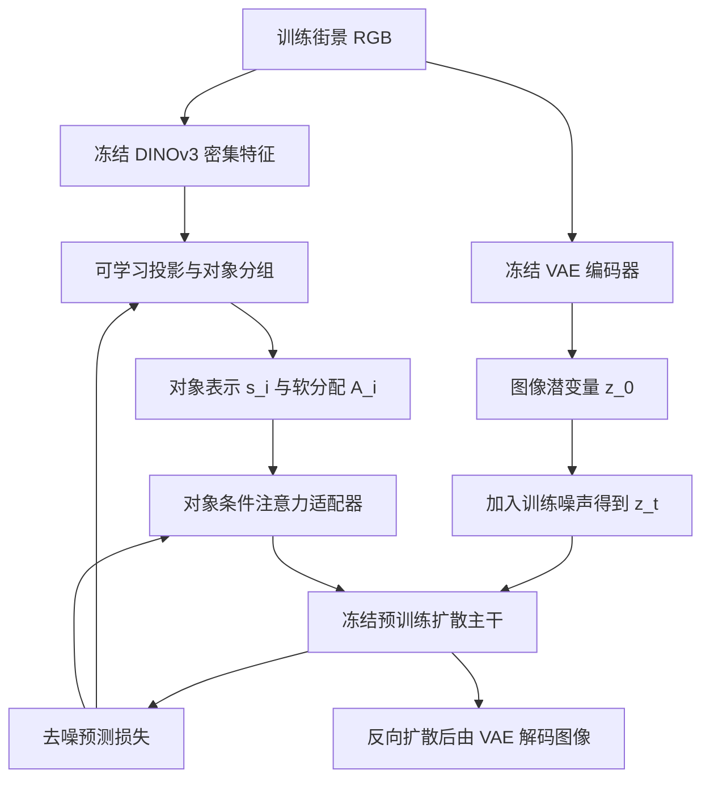

# DINOv3 街景视觉基因：重新设计实验

## 这次修改的判断

保留 DINOv3 作为语义特征来源，改用预训练图像生成主干。先验证图像条件能够传入生成器，再验证对象瓶颈，最后检验对象编辑与重新组合。每一步分别评价，避免用清晰图像替代实例发现的证据。

上一轮实际是“DINOv3 特征分组 + 从零训练的小型 RGB 探针”。它并没有实现预训练扩散模型或自回归图像生成器。这一解码器选择不足以支撑高保真生成的判断。

## 已查明的失败来源

| 环节 | 上一轮实际设计 | 造成的约束 | 新方案 |
| --- | --- | --- | --- |
| 特征 | 1024 维 DINOv3 经 PCA 压成 64 维，保留 75.35% 方差 | 已丢弃部分特征；特征方差也不等同于纹理信息 | 使用原始 1024 维缓存，训练可学习投影；保留原空间网格 |
| 对象瓶颈 | 16/32 个 96 维 slot | 多棵相似树容易合并；背景容易被几何切块 | 联合训练分组与生成适配器，单独评价实例粒度 |
| 学习目标 | 分组仅重建 DINOv3 特征 | 同类别树木合并也能获得低误差 | 扩散去噪 + 特征辅助重建 + 学习到的注意力对应关系 |
| 外观学习 | 分组冻结后训练 RGB 重建 | 图像目标无法改进对象表示 | 对象分组和条件适配器共同训练 |
| 图像生成 | 512 张图从零训练、112×112、像素 MSE | 缺少生成先验；平均化、模糊 | 冻结预训练 VAE 和扩散主干，先训练轻量适配器 |
| 评价 | 特征 MSE、整体 shuffle、区域占据数 | 不能证明每棵树独立或形态/外观可控 | 单树匹配、对象干预、未编辑区域保持、条件依赖 |

仅加大 slot 数、提高输出分辨率、换成更大的 MSE 解码器，缺少针对上述失败来源的充分依据。PCA 方差比例不能用于估计丢失了多少可见图像细节。

## 推荐架构与各分支的职责

以 SlotAdapt 为基础设计一条 **DINOv3 + 对象表示 + 预训练扩散** 路线。原 SlotAdapt 的真实图像实验使用 DINOv2；换成 DINOv3 是需要验证的改动。

训练噪声目标可写为：

\[
F=D_{\mathrm{DINOv3}}(I),\qquad
(S,A)=G_\phi(F),\qquad
z_0=E_{\mathrm{VAE}}(I),
\]

\[
z_t=\alpha_tz_0+\sigma_t\epsilon,\qquad
\mathcal L_{\mathrm{diff}}=
\mathbb E_{I,t,\epsilon}\left[
\|\epsilon-\epsilon_{\theta,\psi}(z_t,t;S)\|_2^2
\right].
\]

其中 \(\theta\) 为冻结生成主干，\(\psi\) 为新适配器，\(\phi\) 为分组网络。VAE 潜变量缩放与噪声参数化须采用所选预训练主干的原始配置；若采用 velocity prediction，则按其参数化修改目标。

这里的 \(U_i\) 对应学习得到的第 \(i\) 个对象候选，起初由 \((s_i,A_i)\) 表示。\(A_i\) 是分组网络从特征中学出的软空间分配，不是人工实例 mask。一个候选是否对应独立物体，需要在测试集验证。

推理时从随机潜变量噪声开始，只给对象条件。若直接把原图潜变量当起点做低噪声 img2img，生成器可能从起点保留整幅图，因此不能据此证明对象编码足够生成图像。

### 第一轮联合训练的具体起点

采用 Stable Diffusion 1.5 作为成本较低的生成基线，448×448 输入，冻结 VAE、UNet 原有参数及 DINOv3。读取当前对应原图的 28×28×1024 特征缓存，学习 1024→256 的投影。先比较密集 patch 条件和 32 个 256 维 slot 条件；64-slot 对照仅在出现明确容量不足时加入。

新增条件注意力层，将对象表示传入 UNet 的上/下采样块；保留一个来自 slots 汇聚的全局条件 token，并通过“只保留全局 token”的对照检查生成器是否绕过实例条件。原 SlotAdapt 将注意力指导作用于第三个上采样块；这里先采用其机制，再依据验证对照决定改动。指导目标来自分组网络自身的软分配，不读取外部实例 mask。

初始先训练去噪目标；分组注意力形成可用结构后逐步加入注意力一致性损失。特征重建可作为辅助项，其作用通过去除该项的对照确定。禁止只凭去噪损失下降判定成功，因为低噪声潜变量本身就包含大量图像信息。

密集与 slot 两条路径共用图像划分、生成主干、训练图像暴露量与采样配置，比较未见图片上的生成与条件干预。先完成原图对应重建，再考虑训练对象布局分布。此处为实现起点，不是本轮已经完成的模型。

### 外观与位置如何处理

第一版先检验联合对象条件能否工作，不把一个向量的若干维提前命名为形态、颜色等已解耦因素。

若对象能够拆开，但无法保留原来的材质和颜色，再加入外观分支：用同一个学习到的 \(A_i\) 在 VAE 潜变量或浅层视觉特征中聚合局部外观 token。外观只通过相应对象的条件接口进入生成器，并控制 token 数量；不能整张图无约束地跳连到生成器，否则可能绕过对象表示。

位置、尺度与软形状可先从 \(A_i\) 得到中心、二阶矩和局部坐标系。它们是可操纵的初始空间参数，尚不证明与语义完全解耦。后续在局部坐标中编码外观并进行位置/外观分别干预，再判断是否形成有用的因子分解。

## 实验顺序与继续条件

| 实验 | 输入与训练 | 要回答的问题 | 下一步条件 |
| --- | --- | --- | --- |
| 0. 图像编解码对照 | 原图 → 预训练 VAE → 图像，无训练 | 所选图像编解码器是否能保留这些街景的细节？ | 固定样本的树干、路边、建筑边界足够清晰；这里只评价编解码 |
| 1. 密集条件对照 | 原始 DINOv3 patch tokens → 适配器 → 预训练扩散，从随机噪声生成 | 不加对象压缩时，DINOv3 条件是否足以控制生成？ | 原/乱序/跨图替换条件产生相应差异；形态布局有对应关系 |
| 2. 对象瓶颈 | DINOv3 → 联合训练分组 → 同一扩散生成器 | 加入对象表示后，细节和实例粒度损失多少？ | 同类实例可分开；条件仍被利用；多次初始化结果稳定 |
| 3. 外观与空间干预 | 必要时加对象局部外观分支；修改单个对象条件 | 能否只改一棵树或移动一个对象？ | 编辑作用在目标实例；其他实例保持；各因子变化符合操作 |
| 4. 新组合生成 | 使用来自不同图片的对象、改变布局 | 是否支持未见组合？ | 有明确对象对应和组合成功率，不能只看自然度 |

实验 1 是诊断对照。完整 patch tokens 的生成结果即使很好，也不等于发现了景观单元。若其外观不忠实，可以在这个阶段先检查局部细节条件是否必要，再把同一条件机制纳入对象瓶颈。

## 逐棵树的问题要单独解决

现有 DINOv3 缓存来自 448×448 输入、28×28 patch 网格。远处的树可能只占几个 patch，相邻树冠还可能连续。预训练扩散能生成清晰树木，但可能改变树的数量或补出原图不存在的边界。

先建立有足够可见树干和边界的固定测试子集，并在**评价集**画实例轮廓。训练继续只用图像及自监督特征。报告匹配后的实例 IoU/召回、同类合并率、单体碎片率和单树编辑影响区域。评价实例定义保持一致，例如树干明显但树冠相连的情况如何计数；这些评价标签不进入训练或按跨城市测试结果调整训练参数。

如果图像恢复已经良好，但相邻树仍被合并，下一步给分组学习增加能够区分实体的自监督证据：优先使用有真实重叠、可建立对应的多视角或视频。可见同一实体在不同画面中保留身份，为实例分组提供单张图像重建没有的约束。

原数据中 0/90/180/270 的四个方向不能自动视为同一棵树的多视角；必须核实视场重叠与对应。若只有单张图像，可先试全局/局部裁剪一致性、提高真实 DINOv3 提取分辨率等，但它们没有保证逐棵树可辨识。高分辨率需要有授权的 DINOv3 权重重新提取特征，不能将 28×28 缓存插值后当作新增细节。

## 如何防止“生成很漂亮但基因没用”

固定随机种子与初始噪声，对同一场景依次测试：原条件、整组跨图替换、只保留全局 register token、只保留对象条件、删去单个对象、交换一个对象外观、移动一个对象位置。若采用外观分支，再分别屏蔽语义与外观条件。

分别测量图像对应程度、目标实例变化、未编辑区域变化，以及对象分组准确性。删除 slot 后把它重新交给其他 slot，可能导致对象仍被重新生成，需实际检验。注意力对齐损失只能加强生成器与分组网络的联系，不能独立作为物理实例发现的证据。

图像评价采用 LPIPS/结构相似度与固定样本视觉检查；重建任务补充 PSNR。实例评价使用独立测试标注。小样本不把 FID 当主要成功指标。跨城市测试只用于最终评价，调参与检查点选择使用验证集。

## 数据、算力与实现范围

- 当前 512 张图适合确认接口和短程诊断；正式联合训练应扩展到既有缓存中按全景去重划分的更多街景。先做短程对照再依据验证曲线决定扩展，不给训练步数作成功保证。
- SlotAdapt 原论文在 COCO 上训练约 250K 步，batch 32，使用 2 张 A40；这与之前几千步的小网络试验不可直接比较。
- 当前共享 GPU 被其他任务大量占用，不能以现有少量空闲显存承诺完成全模型训练。本轮 VAE 对照在 CPU 上运行。
- 本阶段不使用树/房屋类别、框、人工实例 mask 或分割伪标签作为训练监督。预训练图像生成主干已经接受过其原始训练数据和条件监督，因此准确表述是“下游对象发现无需实例标注”，不是全部模型从零无监督。
- 本轮未训练 DINOv3 条件扩散、对象布局先验或解耦外观模型。新增结果仅为预训练 VAE 图像编解码诊断。

## 已核实的研究出处

- [SlotAdapt 论文](https://arxiv.org/abs/2501.15878)：DINOv2、Slot Attention、冻结 Stable Diffusion 与新注意力适配器，联合无实例标签训练和注意力对齐；真实图像实例拆分/组合结果。其 [公开 GitHub 仓库](https://github.com/kaanakan/SlotAdapt) 在本次检查时只包含项目网站资源，不能当作可直接执行的官方训练实现。
- [SlotDiffusion](https://slotdiffusion.github.io/)：对象条件潜空间扩散，另一个生成基线。
- [DINOSAUR](https://arxiv.org/abs/2209.14860)：自监督视觉特征重建用于对象发现，不能代替高保真图像生成验证。
- [SLATE](https://arxiv.org/abs/2110.11405)：对象条件的自回归图像 token 解码。已有思路可行，当前小样本从零训练图像自回归模型的成本与预训练先验缺失仍需解决，因此本轮优先预训练扩散路线。
- [预训练 VAE 模型说明](https://huggingface.co/stabilityai/sd-vae-ft-mse)：图像编解码对照使用的权重；公开 ModelScope 镜像与 SHA256 记录在本目录 `models/sd-vae-ft-mse/source.json`。
