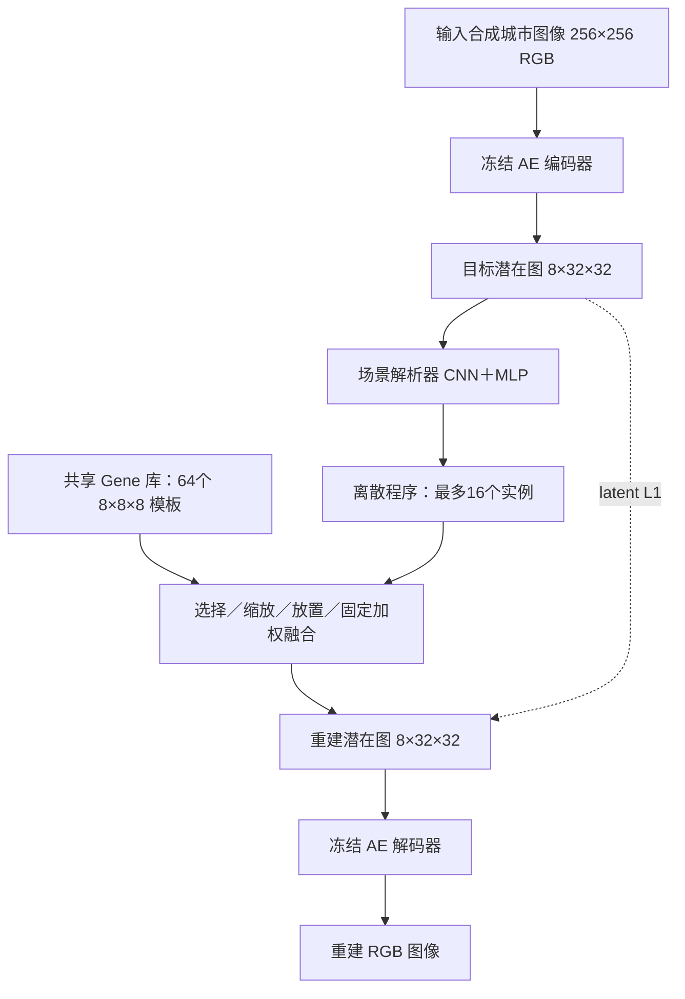

# UrbanGene V0 当前实验步骤说明

整理日期：2026-11-08（北京时间）。本文根据当前代码、配置和执行记录整理。

**当前进度：模型与评估代码已实现，CPU 小样本检查已完成；正式 AE 预训练、主 Gene 训练和完整对照实验尚未启动，队列正在等待资源。**

## 1. 实验要回答什么问题

研究目标是：能否学习一组跨场景共享的视觉基因，通过有限次调用和明确的空间组合操作，以较低的场景编码成本重建城市图像，并适应训练中未出现的因素组合。

本轮主要检验四件事：

1. 有限 Gene 库能否表达不同场景。
2. 在报告场景比特数和共享模型成本后，表示是否有效率优势。
3. 模型能否重建训练时未出现的因素组合。
4. 重复构件增加时，能否继续复用同一套 Gene。

Gene 不要求具有人工可命名语义，也不要求与树木、建筑等物体一一对应。本轮主任务是**输入图像后的组合式重建**；从随机先验生成新场景、无目标图像的组合生成和真实街景训练留待后续独立实验。

## 2. 整体框架



训练先后关系是：

```text
实现与小样本检查
  → 合成数据划分
  → 单独训练 AE
  → 检查重建质量并冻结 AE
  → 训练主 Gene 模型
  → 检查输入依赖
  → 基线／容量／坐标精度实验
  → 锁定配置与检查点
  → 独立评价器与最终测试
```

## 3. 先理解两个模型

### 3.1 图像 AE：负责图像与潜在画布之间的转换

当前使用自建的确定性轻量卷积 Autoencoder，从合成训练集单独训练。

正式版编码器：

| 层 | 输出形状（通道×高×宽） |
|---|---|
| RGB 输入 | 3×256×256 |
| 3×3 卷积，stride=2，SiLU | 24×128×128 |
| 3×3 卷积，stride=2，SiLU | 48×64×64 |
| 3×3 卷积，stride=2，SiLU | 96×32×32 |
| 3×3 卷积，stride=1 | 8×32×32 |

解码器先将8通道映射到96通道，再通过三次最近邻上采样及卷积逐步恢复空间尺寸，输出3通道图像，末端使用 Sigmoid。

AE 的损失是平均 RGB L1：

\[
\mathcal L_{\mathrm{AE}}
=\operatorname{mean}\left|x-D_{\mathrm{img}}(E_{\mathrm{img}}(x))\right|.
\]

AE 训练结束后，编码器和解码器都冻结，并由所有 Gene 方法共用。原始 AE 的重建质量作为参考上限，用于区分解码器本身的失真与 Gene 瓶颈引入的失真。

### 3.2 主 Gene 模型：负责把画布写成离散程序并重建

模型包括场景解析器、共享 Gene 库和固定组合渲染器。

**共享 Gene 库：**

\[
\mathcal G=\{g_1,\ldots,g_{64}\},
\qquad g_k\in\mathbb R^{8\times8\times8}.
\]

每个 Gene 是8通道、空间尺寸8×8的可学习 latent 模板。同一个 Gene ID 在所有图像中使用同一份参数。

**场景解析器：**两层 stride=2 的 CNN，将8×32×32目标 latent 变成48×8×8特征；随后经展平和 MLP 输出16个实例槽位的分类预测。

每张图的离散程序为：

\[
P_x=\{(k_j,v_j,u_j,s_j)\}_{j=1}^{16}.
\]

| 字段 | 含义 | 正式版设置 |
|---|---|---|
| \(k_j\) | Gene ID | 64选1 |
| \(v_j\) | 是否启用 | 0或1 |
| \(u_j\) | 放置位置 | 16×16离散位置网格 |
| \(s_j\) | 尺度 | 0.5、1.0、1.5三选1 |

64是全数据集共享的模板种类数；16是单张图允许的最大调用次数。一个 Gene 可以在不同位置、不同尺度被多次调用。槽位是模板实例的容器，不预设为物体实例。

训练时使用 Straight-through Gumbel-Softmax；前向取离散选择，反向使用近似梯度。推理使用 argmax，保存的场景程序仅包含整数。

**固定组合渲染器：**根据程序查找模板、缩放并放入8×32×32画布，重叠区域采用固定加权归一化融合。空槽位无贡献，未覆盖区域为零 latent；零 latent 不等于黑色 RGB。融合对槽位顺序不敏感，当前没有显式前后遮挡层次。

重建端只接收离散程序和共享模板。没有自由连续场景残差或图像跳连。主模型可训练参数约165万，包括解析器和 Gene 库。

## 4. 步骤一：准备可控合成数据

使用 Pillow 程序化生成256×256 RGB城市示意图，记录 scene_spec。生成参数仅用于划分、审计和评价，不提供给 Gene 解析器或 AE 作为标签。

主要因素包括：

- 建筑形态：3种。
- 立面形式：3种。
- 植被布局：3种。
- 道路宽度、建筑相对高低、树木数量。
- 随机颜色、建筑尺寸、地平线和位置扰动。

### 数据规模

| split | 数量 | 用途 |
|---|---:|---|
| train | 20,000 | 训练 AE 和 Gene |
| val_seen | 2,000 | 检查训练与选择检查点 |
| test_seen | 2,000 | 已见组合规则下的新图像 |
| test_unseen_combo | 2,000 | 保留因素组合的独立测试 |
| test_higher_complexity | 2,000 | 增加重复构件数量的测试 |
| 合计 | 28,000 | 固定生成清单，图像按需渲染 |

### 组合隔离规则

建筑形态×立面×植被布局共有27个三因素组合。训练规则使用21个，另外6个只在未见组合测试中出现。

每个单因素值和每一种二因素组合都包含在训练规则中，避免把“从未见过某一因素”误当作组合泛化。

训练树木数量为1–3，复杂度测试为4–5。按两个建筑、道路和树木计，复杂度测试的声明构件数为7–8，未超过容量矩阵中最小的M=8。但这不保证8个 Gene 槽位足够表达全部细节。

各划分使用独立 seed 和不同完整场景参数化，审计结果保存至 audit.json。已检查 seed 与完整参数化无交集；未进行全部渲染图像的像素哈希去重。

## 5. 步骤二：CPU smoke 与工程检查

先使用小规模配置验证训练链路：

| 项目 | smoke 配置 | 正式主配置 |
|---|---:|---:|
| 训练图像 | 32 | 20,000 |
| 各验证／测试集 | 8 | 2,000 |
| AE latent 通道 | 4 | 8 |
| AE 卷积基础宽度 | 8 | 24 |
| Gene 数K | 32 | 64 |
| 最大实例数M | 8 | 16 |
| batch size | 4 | 32 |
| AE／Gene epochs | 各3 | 各30 |

已完成16项测试，覆盖数据划分、预算与程序序列化、空槽位、重复调用、渲染梯度、固定程序无旁路、训练和评价链路、队列资源检查等。

四种模型的 CPU smoke 已实际完成，保存了检查点、loss曲线和重建图。小样本 AE 与 Gene 重建质量仍差，这一步仅证明工程可运行。

## 6. 步骤三：正式训练图像 AE

1. 使用 train 训练，用 val_seen 评价平均 RGB L1。
2. Adam，学习率3×10⁻⁴，batch32，30 epochs，seed42。
3. CUDA 可使用 bf16 autocast；CPU 使用float32。
4. 每 epoch 保存指标、last.pt和验证L1最低的best.pt。
5. 在完整 val_seen 上检查 AE 重建图、PSNR、SSIM和 RGB L1。
6. 当前队列要求验证PSNR至少24 dB，才进入 Gene 阶段。
7. 通过后冻结 AE，并缓存训练／验证的目标 latent；测试 latent 不预先缓存。

24 dB是本轮预先选择的工程继续条件，不是领域共识，也不能代替细结构和属性保真度检查。条件未达到时，队列记录 diagnosis_required 并停止扩展实验。

## 7. 步骤四：训练主 Gene 模型

固定配置：K=64、M=16、Gene尺寸8×8、位置网格16×16、三种尺度。

训练唯一损失为平均 latent L1：

\[
\mathcal L_{\mathrm{Gene}}
=\operatorname{mean}\left|
E_{\mathrm{img}}(x)-\operatorname{Render}(\mathcal G,P_x)
\right|.
\]

更新对象只有解析器和 Gene 模板。AE不更新；不加入独立的语义、组合、正交、稀疏或MDL损失。单独训练评价器时的分类目标不属于 Gene 训练。

训练设置为 Adam、lr3×10⁻⁴、batch32、30 epochs、梯度范数裁剪1.0、float32。Gumbel温度随epoch从1.0降至0.5。每 epoch 按完整 val_seen 的确定性解码 latent L1 选择检查点。

### 验证程序是否真正携带输入信息

对同一批目标图像，比较：

- 使用各自图像解析出的正确程序。
- 在批内跨图打乱整份程序。
- 零 latent 的参考误差。

当前继续条件是正确程序的latent L1比打乱程序至少低1%：

\[
1-\frac{L_{\mathrm{correct}}}{L_{\mathrm{shuffled}}}\geq0.01.
\]

这是排除明显退化解的最低检查，不代表组合性已经成立。未通过时停止后续13组实验，先检查槽位塌缩、模板利用率、位置预测、梯度和失败案例。

## 8. 步骤五：运行基线与容量实验

主模型通过继续条件后，依次运行以下实验，总计14组 Gene 训练。

### 8.1 三个基线

| 方法 | 结构 | 主配置下的程序bits | 可训练参数 |
|---|---|---:|---:|
| UrbanGene | Gene可重复调用，带位置、尺度和融合 | 272 | 1,650,672 |
| B0 | 规则网格离散patch编码，无显式实例位置与尺度 | 252；字节存储256 | 1,649,780 |
| B1 | 共享模板全局缩放后求和，无空间放置 | 112 | 1,651,906 |
| B2 | 相同组合器，每张图禁止重复Gene ID | 272 | 1,650,672 |

各组共用冻结 AE、训练集、batch和epoch数，通过调整有效隐藏层宽度使参数规模接近。

B0的程序位数比主模型少约7.4%；B1明显更低，只作为结构消融。不能把它们的性能差异全部归因于组合机制，也不能声称全部对照信息预算严格相同。

### 8.2 容量矩阵

\[
K\in\{32,64,128\},\qquad M\in\{8,16,32\}.
\]

共9组，包含已训练的K64/M16主模型，因此额外训练8组。
K与M变化时，程序位数和模型参数量也会变化，结果中同时报告。

### 8.3 坐标精度

固定K64/M16，位置网格比较8×8、16×16和32×32；16×16已包含在主模型中，额外训练两组。
其理论程序码长分别为240、272、304 bits/scene。

因此总量是：1个主模型＋3个基线＋8个额外容量配置＋2个额外坐标配置＝14组。

每组30 epochs，共18,750次参数更新；14组最多262,500次Gene参数更新，另计AE与评价器训练。实际耗时以日志记录为准。

## 9. 步骤六：信息预算检查

主模型每个槽位的固定编码为：

\[
\underbrace{6}_{\text{Gene ID}}
+\underbrace{1}_{\text{启用}}
+\underbrace{8}_{\text{位置}}
+\underbrace{2}_{\text{尺度}}
=17\ \text{bits}.
\]

16个槽位共272 bits，即34 bytes/scene。关闭的槽位也按完整字段计费，三种尺度以两位存储，未使用的类别码不作为额外信息通道。

每次评价会实际序列化程序、反序列化，再用恢复的程序重建latent，检查与原程序输出是否一致。额外报告字节填充后的大小。

场景程序之外，共享 Gene 库有32,768个参数，fp32约128 KiB；解析器和冻结AE权重分别计入共享模型成本。

272 bits只是每图程序码长，不能解释为包括共享模型成本的通用图像压缩率。第一版采用固定槽位码长，启用实例少不会自动减少存储。

## 10. 步骤七：锁定协议并进行独立测试

### 10.1 锁定

所有固定配置根据val_seen选好检查点后，队列保存 TEST_PROTOCOL_LOCK.json。正式测试不参与模型、阈值或检查点选择。

### 10.2 独立属性评价器

为测量属性与关系是否保留，单独训练轻量分类评价器：

- 使用专用合成校准语料，默认5,000训练图、1,000验证图、10 epochs。
- 覆盖全部27个因素组合与1–5棵树；seed命名空间与Gene数据隔离。
- 预测建筑形态、立面、植被布局、道路宽度、建筑高低关系、树木数量。
- 标签只用于评价器训练，不参与AE或Gene训练。
- 先评原始测试图；某属性原图准确率低于85%，该属性重建分数标记为不可靠。

### 10.3 三类测试

| 测试 | 主要问题 | 当前允许的结论 |
|---|---|---|
| test_seen | 熟悉组合规则下能否保持重建质量 | 已见规则下的重建能力 |
| test_unseen_combo | 新的因素组合能否被表示 | 未见组合的表征泛化 |
| test_higher_complexity | 重复构件增加时质量是否保持 | 固定Gene库下的复杂度扩展表现 |

重建指标为latent L1、RGB L1、PSNR和7×7均匀窗口SSIM；同时报告属性评价、按树木数量分组的指标、Gene使用率、启用实例数及失败案例。

对未见组合目标图像进行编码重建，不等于在没有目标图像时生成该组合。后者需要额外的配对重组或生成先验实验。

当前正式自动队列只有训练seed42，尚未安排多训练种子确认；不能据此给出稳定优越性结论。

## 11. 产物与执行入口

### 主要产物

| 位置／文件 | 内容 |
|---|---|
| configs/v0_64genes.yaml | 正式主模型配置 |
| configs/smoke.yaml | CPU小样本配置 |
| outputs/data/full/ | 正式数据生成清单、audit.json和预览 |
| outputs/smoke/ | 已执行的tiny训练与评价 |
| outputs/v0/plan.json | 14组实验、继续条件与源码指纹 |
| outputs/v0/queue_status.json | 实时执行状态 |
| 各训练目录的best.pt／last.pt | 最佳／最近检查点 |
| config.yaml／history.json／loss_curve.png | 配置和训练记录 |
| 各eval目录 | metrics.json、metrics.csv、逐图结果和programs.bin |
| recon_grid.png／failure_cases.png | 原图／AE／Gene重建与失败图 |
| gene_usage.png／gene_templates.png／instances.png | 模板使用、孤立模板和实例覆盖 |
| 实验根目录 | rate_distortion.png、seen_unseen_comparison.png；完整正式测试后有results.csv |

### 可复现命令

以下命令在项目目录执行：

```bash
cd /root/code/urban-visual-gene/urbangene

# 工程检查；只用于复现已有小样本流程
python -m pytest -q
urbangene generate --config configs/smoke.yaml
python scripts/run_smoke.py
urbangene evaluate --checkpoint outputs/smoke/urbangene/best.pt --split test_unseen_combo
```

正式数据及实验计划的构建命令：

```bash
urbangene generate --config configs/v0_64genes.yaml
urbangene plan --config configs/v0_64genes.yaml --output outputs/v0
```

启动或恢复队列的命令：

```bash
urbangene queue --plan outputs/v0/plan.json
```

**当前已有后台队列，不需要重复启动。**队列由文件锁防止本地重复执行；运行中修改Python源码会触发指纹检查，需另行核对计划。上面命令是复现说明，不表示本文整理时重新执行了训练。

## 12. 实际进度与下一步

截至本文整理时：

| 环节 | 状态 |
|---|---|
| 项目、模型、CLI与评价代码 | 已实现 |
| 工程测试 | 16项已通过 |
| 合成数据manifest、隔离规则、审计与预览 | 已准备 |
| 32图CPU smoke，AE与四种Gene方法 | 已运行；质量仍差，仅用于工程验证 |
| 正式AE训练 | 未启动 |
| 正式主Gene训练 | 未启动 |
| 其余13组正式对照 | 未启动 |
| 正式独立测试与科学结论 | 未完成 |

最新状态文件为 waiting_for_resources，记录磁盘空闲为0 GiB。队列要求磁盘至少余2 GiB；同一GPU连续三次满足利用率不超过10%、空闲显存至少12,000 MiB，检查间隔45秒。资源检查并不等于独占调度预约。

下一步是资源满足后先进行正式AE训练。AE和主Gene分别通过预设继续条件后，才展开完整实验矩阵。若未通过，保存诊断并停止扩展实验。

本轮尚未证明：Gene优于普通离散编码、出现了稳定组合泛化、支持语义独立编辑、能够无目标生成新场景，或找到了数学意义上的最少基因集合。

相关文档：[项目需求](REQUIREMENTS.md)、[训练安排](TRAINING_PLAN.md)、[运行说明](README.md)。实时状态以outputs/v0/queue_status.json为准。
